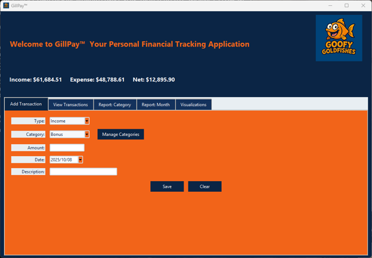

# GillPay™ — Personal Finance & Budget Tracker

A modular desktop personal finance application built in **Python**, featuring both a **Tkinter Graphical User Interface (GUI)** and a **Command-Line Interface (CLI)** with persistent CSV storage and embedded **Matplotlib** analytics.

## Overview & Key Features
Managing personal budgets requires reliable data entry, categorization, and clear spending visibility. GillPay™ solves this through a layered architecture separating data access, business logic, and presentation:
* **Dual Interface Support (GUI & CLI):** Full tabbed Tkinter desktop app (`Add Transaction`, `View Transactions`, `Category Report`, `Monthly Report`, and `Visualizations`) alongside a fast terminal menu.
* **Data Validation & Integrity:** Enforces strict input rules for date formats (`YYYY/MM/DD`), numeric currency values, duplicate prevention, and dynamic income/expense category management.
* **Interactive Financial Reporting:** Filterable transaction tables and embedded Matplotlib charts tracking top expense categories, income vs. expenses, and monthly net cash flow.
* **One-Click Environment Setup:** Cross-platform launcher scripts (`run.bat`, `run.ps1`, `run.sh`) automatically provision a local virtual environment, install dependencies, and launch the GUI.

## Application Preview



## Project Architecture
```text
gillpay-finance-tracker/
├── data/                  # Persistent CSV storage (gillpay_data.csv, categories.csv)
├── gui/                   # Tkinter GUI entry point (app.py)
├── images/                # Application branding and UI screenshots
├── src/
│   ├── dao/               # Data Access Objects (transaction_dao.py, category_dao.py)
│   ├── models/            # Transaction dataclass and validation rules (transaction.py)
│   ├── ui/                # Modular GUI tabs, dialogs, charts, and theme styling
│   ├── gillpay_service.py # Core business logic and aggregation layer
│   └── main.py            # CLI entry point
├── GillPay_Architecture_Report.pdf
├── requirements.txt
└── run.bat / run.ps1 / run.sh
