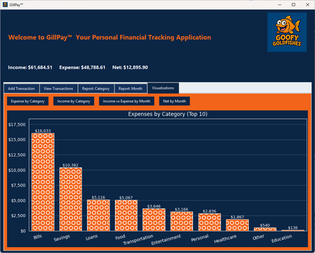

# GillPay™ — Personal Finance & Budget Tracker

A modular desktop personal finance application built in **Python**, featuring both a **Tkinter Graphical User Interface (GUI)** and a **Command-Line Interface (CLI)** with persistent CSV storage and embedded **Matplotlib** analytics.

## Overview & Key Features
Managing personal budgets requires reliable data entry, categorization, and clear spending visibility. GillPay™ solves this through a layered architecture separating data access, business logic, and presentation:
* **Dual Interface Support (GUI & CLI):** Full tabbed Tkinter desktop app (`Add Transaction`, `View Transactions`, `Category Report`, `Monthly Report`, and `Visualizations`) alongside a fast terminal menu.
* **Data Validation & Integrity:** Enforces strict input rules for date formats (`YYYY/MM/DD`), numeric currency values, duplicate prevention, and dynamic income/expense category management.
* **Interactive Financial Reporting:** Filterable transaction tables and embedded Matplotlib charts tracking top expense categories, income vs. expenses, and monthly net cash flow.
* **One-Click Environment Setup:** Cross-platform launcher scripts (`run.bat`, `run.ps1`, `run.sh`) automatically provision a local virtual environment, install dependencies, and launch the GUI.

## Application Preview



## Project Architecture
```text
gillpay-finance-tracker/
├── data/                  # Persistent CSV storage (gillpay_data.csv, categories.csv)
├── gui/                   # Tkinter GUI entry point (app.py)
├── images/                # Application branding and UI screenshots
├── src/
│   ├── dao/               # Data Access Objects (transaction_dao.py, category_dao.py)
│   ├── models/            # Transaction dataclass and validation rules (transaction.py)
│   ├── ui/                # Modular GUI tabs, dialogs, charts, and theme styling
│   ├── gillpay_service.py # Core business logic and aggregation layer
│   └── main.py            # CLI entry point
├── GillPay_Architecture_Report.pdf
├── requirements.txt
└── run.bat / run.ps1 / run.sh
```
## Prerequisites
* **Python 3.11 – 3.13** (Python `3.13` recommended; Python `3.14+` is not currently supported due to `pandas<3.0.0` dependency constraints)
* **Tkinter** (included automatically with standard Windows and macOS Python installers; Linux users may need `sudo apt install python3-tk`)

## Quick Start
### Windows (Recommended)
Double-click `run.bat`. The script will automatically create `.venv_local`, install dependencies from `requirements.txt`, and launch the GUI.  
*(If PowerShell script execution is blocked, run: `powershell -ExecutionPolicy Bypass -NoProfile -File .\run.ps1`)*

### macOS / Linux
```bash
chmod +x run.sh
./run.sh
```

### Manual Launch
`python3 -m venv .venv_local`
#### Activate virtual environment, then install dependencies:
`python -m pip install -r requirements.txt`

#### Launch GUI:
`python -m gui.app`

#### Or launch CLI:
`python -m src.main`

## Contributors & Acknowledgments
### Project Team
Ally Herleth, Matthew Bennett, Ruben Alvarez, Enoch Adegbola, and Jo Ann Kern

### AI Transparency
Generative AI (ChatGPT) was used during development to assist with docstrings, exception-handling patterns, and technical documentation, with all code reviewed and validated by the team.

## Disclaimer & License
This software is a portfolio and educational project built to demonstrate modular Python architecture and desktop GUI development. It stores data locally in unencrypted CSV files and is provided "as is" for personal demonstration purposes only—not for commercial or production financial use.
